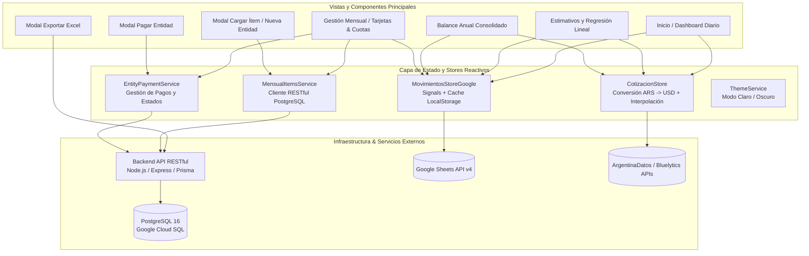
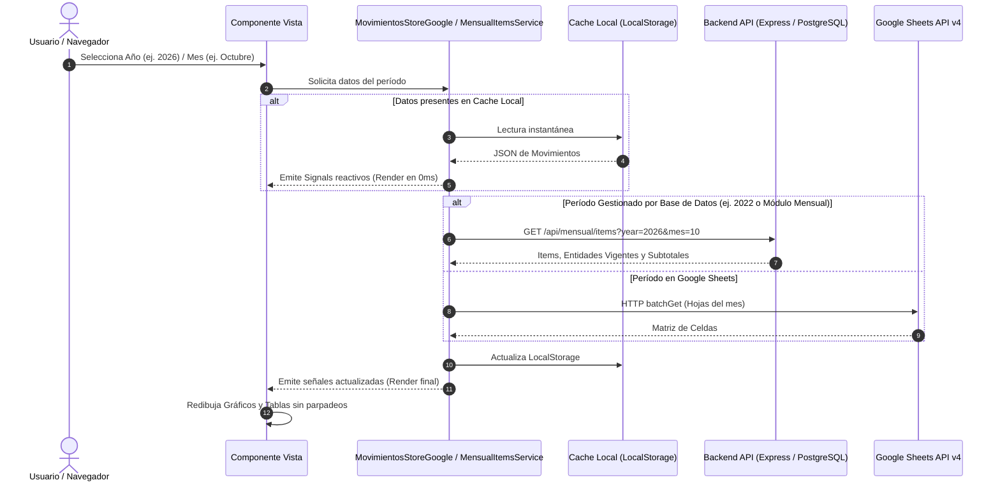

# 📊 Control de Gastos - DML (Frontend)

Sistema integral de gestión, proyección y auditoría contable personal bimonetaria de alto rendimiento desarrollado en **Angular 20 (Standalone Components + Signals)**, con **Angular Material 3**, **Chart.js**, integración bimonetaria en tiempo real (**ARS / USD Oficial y Blue**) y **Arquitectura Híbrida Cloud** que combina **Google Sheets API v4** con una **API RESTful dedicada en Node.js, Express, PostgreSQL y Server-Sent Events (SSE)**.

---

## 📑 Tabla de Contenidos
1. [Arquitectura General Híbrida](#-arquitectura-general-híbrida)
2. [Flujo de Datos y Reactividad (Signals + SSE)](#-flujo-de-datos-y-reactividad-signals--sse)
3. [Ecosistema Bimonetario y Módulo Dólar (USD)](#-ecosistema-bimonetario-y-módulo-dólar-usd)
   - [APIs de Cotización y Fallback](#1-apis-externas-utilizadas)
   - [Servicios y Stores (`DolarService` y `CotizacionStore`)](#2-servicios-y-stores-del-dólar)
   - [Algoritmo de Interpolación de Dólar en Feriados](#3-algoritmo-de-cotización-vigente-e-interpolación)
4. [Estructura del Proyecto](#-estructura-del-proyecto)
5. [Módulos y Funcionalidades Clave](#-módulos-y-funcionalidades-clave)
   - [1. Dashboard de Inicio (`/inicio`)](#1-dashboard-de-inicio-inicio)
   - [2. Gestión Mensual y Tarjetas de Crédito (`/mensual`)](#2-gestión-mensual-y-tarjetas-de-crédito-mensual)
     - [Catálogo Dinámico de Entidades con Vigencia Temporal](#a-catálogo-dinámico-de-entidades-con-vigencia-temporal)
     - [Carga Masiva por Lotes y Foco Veloz](#b-carga-masiva-por-lotes-y-foco-veloz)
     - [Compresión de Logos en Cliente (WebP Base64)](#c-compresión-de-logos-en-cliente-webp-base64)
     - [Gestión de Pagos de Entidades y Badges de Estado](#d-gestión-de-pagos-de-entidades-y-badges-de-estado)
     - [Intención de Pago en Amarillo bajo el Total](#e-intención-de-pago-en-amarillo-bajo-el-total)
     - [Baja Histórica Inmutable](#f-baja-histórica-inmutable)
   - [3. Exportación Nativa a Excel Multianual (`.xlsx`)](#3-exportación-nativa-a-excel-multianual-xlsx)
   - [4. Estimativos y Proyecciones (`/estimativo`)](#4-estimativos-y-proyecciones-estimativo)
   - [5. Balance Anual Consolidado (`/anual`)](#5-balance-anual-consolidado-anual)
6. [Regla de Oro: Diseño de Tarjetas y Contenedores](#-regla-de-oro-diseño-de-tarjetas-y-contenedores)
7. [Capa de Estado y Servicios (Store Pattern)](#-capa-de-estado-y-servicios-store-pattern)
8. [Plugins y Utilidades Gráficas (Chart.js)](#-plugins-y-utilidades-gráficas-chartjs)
9. [Diseño y Sistema de Tokens (Modo Claro / Oscuro)](#-diseño-y-sistema-de-tokens-modo-claro--oscuro)
10. [Guía para Desarrolladores y Matriz de Pruebas (QA)](#-guía-para-desarrolladores-y-matriz-de-pruebas-qa)

---

## 🏛 Arquitectura General Híbrida

La aplicación opera bajo un modelo **Híbrido Cloud Reactivo**:
- **Google Sheets API v4**: Conexión directa y segura mediante API Keys y consultas batch optimizadas para años en edición activa.
- **Backend API RESTful en PostgreSQL (Cloud SQL)**: Núcleo de persistencia transaccional para años migrados (ej. 2022), catálogo dinámico de entidades, pagos de tarjetas, préstamos y exportación nativa a Excel.
- **Conmutación Inteligente de Origen de Datos**: La UI detecta si el año o mes se alimenta de la Base de Datos o de Google Sheets, mostrando una leyenda visual interactiva (`Origen: Base de Datos` o `Origen: Google Sheets`).
- **Reactividad con Signals**: Renderizado granular y eficiente sin sobrecarga del ciclo de detección de cambios de Angular.
- **Caché Multinivel con Revalidación en Segundo Plano**: Hidratación instantánea desde memoria y `LocalStorage` con sincronización continua.



---

## 🔄 Flujo de Datos y Reactividad (Signals + SSE)



---

## 💵 Ecosistema Bimonetario y Módulo Dólar (USD)

Convierte y enriquece automáticamente todos los saldos diarios, estimaciones y pasivos de pesos argentinos a dólares estadounidenses (**USD Oficial y Blue**):

### 1. APIs Externas Utilizadas
- **`ArgentinaDatos API`**: Fuente principal para cotizaciones oficiales históricas diarias.
- **`Bluelytics API`**: Cotización en tiempo real del día en curso (Oficial y Blue).
- **`Banco Central (BCRA API)`**: Fallback de contingencia si las APIs principales no responden.

### 2. Servicios y Stores del Dólar
- **`DolarService`**: Manejo de caché en memoria y deduplicación de promesas en vuelo para que múltiples componentes compartan la misma llamada de red.
- **`CotizacionStore`**: Store reactivo con Signal `cotizados` que calcula:
  $$\text{Saldo USD} = \frac{\text{Saldo ARS}}{\text{Tipo de Cambio Venta}}$$
  $$\text{Deuda USD} = \frac{\text{Deuda ARS}}{\text{Tipo de Cambio Venta}}$$

### 3. Algoritmo de Cotización Vigente e Interpolación
En fines de semana o feriados bancarios sin cotización oficial, el sistema retrocede automáticamente hasta el último día hábil con cotización de cierre válida (hasta 365 días hacia atrás), asegurando que **nunca aparezcan valores en 0 o NaN** en los gráficos en dólares.

---

## 📁 Estructura del Proyecto

```
src/
├── app/
│   ├── common/                       # Componentes compartidos y modales globales
│   │   ├── modal-exportar-excel/     # Modal de exportación nativa a Excel
│   │   └── not-found/
│   ├── models/                       # Modelos e interfaces TypeScript
│   │   ├── entidad.ts
│   │   └── cotizacion.ts
│   ├── pages/                        # Páginas y vistas principales
│   │   ├── inicio/                   # Dashboard Diario y Gráficos Multianuales
│   │   ├── mensual/                  # Gestión de Tarjetas, Cuotas y Entidades
│   │   │   ├── lista-entidades/      # Tarjetas: Visa, Master, NX, Bancor, ML, Otros
│   │   │   ├── modal-cargar-item/    # Alta de ítems, cuotas y nueva entidad
│   │   │   ├── modal-pagar-entidad/  # Liquidación total/parcial de tarjetas
│   │   │   ├── cuotas-coincidentes/  # Subtotales por planes de cuotas
│   │   │   ├── proyeccion-totales/   # Matriz de proyección anual completa
│   │   │   └── proyeccion-entidad/   # Modal estilo Google Sheets
│   │   ├── estimativos/              # Presupuesto diario vs real y regresión
│   │   └── anual/                    # Matriz anual consolidada y termómetro
│   ├── services/                     # Servicios singleton
│   │   ├── mensual-items.service.ts  # Cliente API para ítems y entidades
│   │   ├── entity-payment.service.ts # Cliente API para pagos de tarjetas
│   │   ├── export-excel.service.ts   # Cliente API para exportación XLSX
│   │   ├── google.sheets.service.ts  # Cliente Google Sheets API v4
│   │   ├── dolar.service.ts          # Integración cambiaria ARS/USD
│   │   └── theme.service.ts          # Control de tema Claro/Oscuro
│   ├── stores/                       # Signals y gestión de estado reactivo
│   │   ├── movimiento.google.ts      # Store principal de movimientos
│   │   └── dolar.store.ts            # Store de cotizaciones y dólares
│   └── utils/                        # Regresiones lineales y plugins Chart.js
├── assets/
│   ├── logos/                        # Logotipos oficiales (Visa, NX, Bancor, etc.)
│   ├── years-and-ranges.json         # Mapeo de celdas y hojas por año
│   └── feriados.json                 # Calendario oficial de feriados
└── styles.scss                       # Tokens CSS globales, layout y temas
```

---

## 🖥 Módulos y Funcionalidades Clave

### 1. Dashboard de Inicio (`/inicio`)
- **Tabla Diaria con Variaciones**: Lista completa de saldos diarios en pesos y dólares con resaltado inteligente de fines de semana y feriados.
- **Gráficos Multianuales Continuos**: Separadores verticales con badges de año flotantes (`yearBackgroundPlugin`) para visualizar la evolución histórica del patrimonio.

---

### 2. Gestión Mensual y Tarjetas de Crédito (`/mensual`)

#### a. Catálogo Dinámico de Entidades con Vigencia Temporal
- Permite crear en cualquier momento nuevas tarjetas de crédito, cuentas bancarias, billeteras o servicios mediante el botón **`+ Nueva Entidad`**.
- Define nombre, tipo (`TARJETA`, `BANCO`, `BILLETERA`, `SERVICIOS`), paleta de colores identificadores y vigencia temporal automática a partir del mes y año en curso.

#### b. Carga Masiva por Lotes y Foco Veloz
- **Buffer en Borrador**: Permite ingresar todos los ítems de una tarjeta nueva de forma continua sin salir del modal.
- **Atajo `Enter` y Foco Automático**: Al presionar `Enter` en el monto o pulsar `+ Agregar ítem a la lista`, el ítem se incorpora a la bandeja acumulada y el cursor regresa de inmediato al campo de **Concepto o Descripción**, permitiendo cargar 20 o más compras en segundos sin tocar el mouse.
- **Detección Automática de Cuotas**: Detecta formatos `1/12`, `2/6`, etc., y activa la opción de auto-propagación hacia meses futuros.
- **Guardado Atómico**: El botón de guardado indica `Guardar Entidad (N ítems)` y despacha toda la configuración en una sola llamada atómica.

#### c. Compresión de Logos en Cliente (WebP Base64)
- Al seleccionar una imagen de logotipo (`PNG`, `JPG`, `WebP`, `SVG`), un `<canvas>` HTML5 la redimensiona a un tamaño compacto de **máx. 100 x 36 px** y la comprime a formato **WebP calidad 0.82**.
- Reduce el peso de cualquier archivo de varios megabytes a tan solo **1.5 KB a 2.5 KB**, guardándose directamente en la base de datos sin necesidad de almacenamiento multipart o servidores S3 externos.

#### d. Gestión de Pagos de Entidades y Badges de Estado
- Botón de pago en pesos (`$`) en cada tarjeta para registrar pagos completos o parciales.
- **Badges Visuales en Cabecera**:
  - 🟢 **`COMPLETO`** (verde con tilde): Liquidación total del saldo del mes.
  - 🟡 **`PARCIAL`** (amarillo con reloj): Pago parcial registrado con saldo remanente.
  - 🔴 **`NO_PAGADO`** (rojo con cruz): Pendiente de pago para el mes.
- Tooltip interactivo con fecha de pago, importe abonado y saldo restante.

#### e. Intención de Pago en Amarillo bajo el Total
- Para tarjetas mensuales (`Visa`, `Mastercard`, `Naranja`, `Bancor`, `Mercado Libre`), cuando el usuario definió una intención de pago parcial para meses futuros, se muestra justo debajo de la fila del `Total` una fila en tipografía ámbar/amarilla (`#facc15` / `#ffd54f`):
  $$\text{Intención de pago: } \$X \quad (\text{Resta: } \$Y)$$
- **Ocultamiento Automático al 100%**: Si la intención de pago cubre la totalidad del resumen (`montoRestante <= 0` o pago en estado `COMPLETO`), el indicador se oculta automáticamente evitando información redundante.

#### f. Baja Histórica Inmutable
- Al dar de baja una entidad o servicio mediante el botón 🗑️ en la cabecera de la tarjeta:
  - Se fija el fin de su vigencia en el mes anterior (`mes - 1`).
  - Se eliminan los ítems del mes actual y futuros.
  - **El historial de meses anteriores permanece 100% inalterado** garantizando la integridad de los balances pasados.

---

### 3. Exportación Nativa a Excel Multianual (`.xlsx`)
- Accesible desde la barra superior (`Exportar Excel`).
- Modal interactivo para seleccionar el año deseado (desde 2022 en adelante).
- Descarga directa de archivos `.xlsx` idénticos a los libros contables originales, con todas las pestañas mensuales (`Enero` a `Diciembre`) y la pestaña consolidada `Anual`.

---

### 4. Estimativos y Proyecciones (`/estimativo`)
- **Termómetro de Progreso de Días**: Barra dinámica adaptativa en gradiente HSL que mide el avance temporal del mes.
- **Curva de Regresión Lineal**: Mide la tendencia del gasto real vs el estimado y la proyección de deuda acumulada.
- **Eliminación Segura de Estimativos**: Botón interactivo de eliminación (ícono de cesto de basura) con modal de confirmación de doble paso (`ModalConfirmacionComponent`) para purgar ciclos erróneos sin dejar registros huérfanos, notificando vía SSE y actualizando el selector mensual.
- **Herencia Contable Automática del Ciclo Anterior**: Al dar de alta un nuevo estimativo (ej. Enero 2027), el sistema localiza automáticamente el último ciclo base disponible (Diciembre 2026), heredando de forma independiente el remanente de saldo real (`remanenteSaldoAnterior`) y la deuda acumulada del cierre (`deudaSugerida`), tanto desde Google Sheets como de PostgreSQL.
- **Simulación del Hito Inicial (Día 8)**: Computa automáticamente el saldo proyectado del primer vencimiento sumando sueldos y deduciendo resúmenes de tarjetas (descontando compensaciones e intenciones de pago), cuotas de préstamos y servicios fijos.

---

### 5. Balance Anual Consolidado (`/anual`)
- Matriz completa de 12 meses consolidando todas las entidades, subtotales y gastos fijos en una sola tabla ejecutiva.

---

## 🛡 Regla de Oro: Diseño de Tarjetas y Contenedores

De acuerdo con las reglas inmutables del proyecto ([`.agents/AGENTS.md`](file:///c:/Datos/David/Proyectos/Control_Gastos/control-de-gastos-front/.agents/AGENTS.md)):
1. **Integridad de Contenedores**: Se debe preservar siempre la estructura del contenedor blanco principal (`<div class="movimientos-wrapper">` con `background: #ffffff`, `border-radius: 12px` y `box-shadow: 0 6px 20px rgba(0, 0, 0, 0.08)`).
2. **Subtarjetas Homogéneas**: Todas las tarjetas de entidades, tablas y gráficos deben conservar sus bordes suaves (`border: 1px solid #e2e8f0`), sombras sutiles (`box-shadow: 0 4px 12px rgba(0, 0, 0, 0.05)`) y ancho igualado al **100%** (`width: 100%`, `box-sizing: border-box`).

---

## 🎨 Diseño y Sistema de Tokens (Modo Claro / Oscuro)

El sistema de tokens CSS ([`src/styles.scss`](file:///c:/Datos/David/Proyectos/Control_Gastos/control-de-gastos-front/src/styles.scss)) garantiza una interfaz moderna y coherente:

```scss
:root {
  --bg-app: #f8fafc;
  --bg-surface: #ffffff;
  --bg-card: #ffffff;
  --border-card: #e2e8f0;
  --text-primary: #1e293b;
  --text-secondary: #64748b;
}

body.dark-mode {
  --bg-app: #0f172a;
  --bg-surface: #1e293b;
  --bg-card: #1e293b;
  --border-card: #334155;
  --text-primary: #f8fafc;
  --text-secondary: #cbd5e1;
}
```

---

## 🛠 Guía para Desarrolladores y Matriz de Pruebas (QA)

### 1. Comandos de Ejecución
```bash
# Instalar dependencias
npm install

# Iniciar servidor de desarrollo (http://localhost:4200)
npm run start
# o
npx ng serve

# Compilación y verificación de tipos en modo desarrollo
npx ng build --configuration development

# Compilación para Producción
npx ng build --configuration production
```

### 2. Matriz de Validación de QA Checklist
- [x] **Carga Masiva de Ítems en Nueva Entidad**: Crear una entidad, agregar 3 o más ítems consecutivamente con la tecla `Enter`, verificar el retorno automático del foco al Concepto y comprobar que al pulsar `Guardar Entidad` se persistan todos en una sola operación.
- [x] **Compresión de Logo**: Adjuntar una imagen de alta resolución (2-5 MB) en la nueva entidad y comprobar que se previsualice correctamente y su tamaño comprimido sea menor a 3 KB.
- [x] **Retorno a Entidades**: En el formulario de nueva entidad, pulsar sobre otra tarjeta existente o sobre `← Volver a entidades` y verificar que el formulario se cierre y se seleccione la entidad elegida.
- [x] **Baja Histórica Inmutable**: Dar de baja una entidad en un mes determinado y verificar que en los meses anteriores se mantenga intacta con todos sus consumos.
- [x] **Badges de Pago e Intención de Pago en Amarillo**: Registrar un pago total o parcial en una tarjeta y comprobar el cambio de badge a verde o amarillo, y a rojo en meses futuros sin pago. Para meses futuros con intención de pago parcial, verificar que aparezca la fila amarilla ámbar debajo del Total con el desglose exacto, y que al abonar el 100% se oculte de inmediato.
- [x] **Eliminación Segura de Estimativos**: Abrir un ciclo estimativo creado por error, presionar el botón de eliminar, confirmar en el modal de verificación y constatar que el ciclo se purga en base de datos y se actualiza el selector reactivo vía SSE.
- [x] **Herencia Automática de Ciclo Base en Estimativos**: Dar de alta un estimativo para Enero 2027 y constatar que cargue automáticamente el saldo remanente y la deuda acumulada del cierre de Diciembre 2026, junto con el desglose preliminar de tarjetas, préstamos y servicios del día 8.
- [x] **Exportación a Excel**: Descargar el libro Excel de cualquier año y abrirlo para verificar que contenga las 12 pestañas mensuales y la anual con estilos idénticos.
- [x] **Modo Claro / Oscuro**: Alternar el tema y validar legibilidad de textos, contraste de badges y actualización de ejes en los gráficos.
